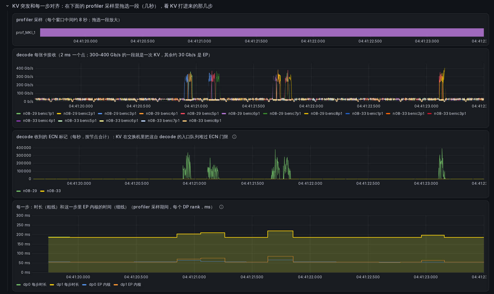
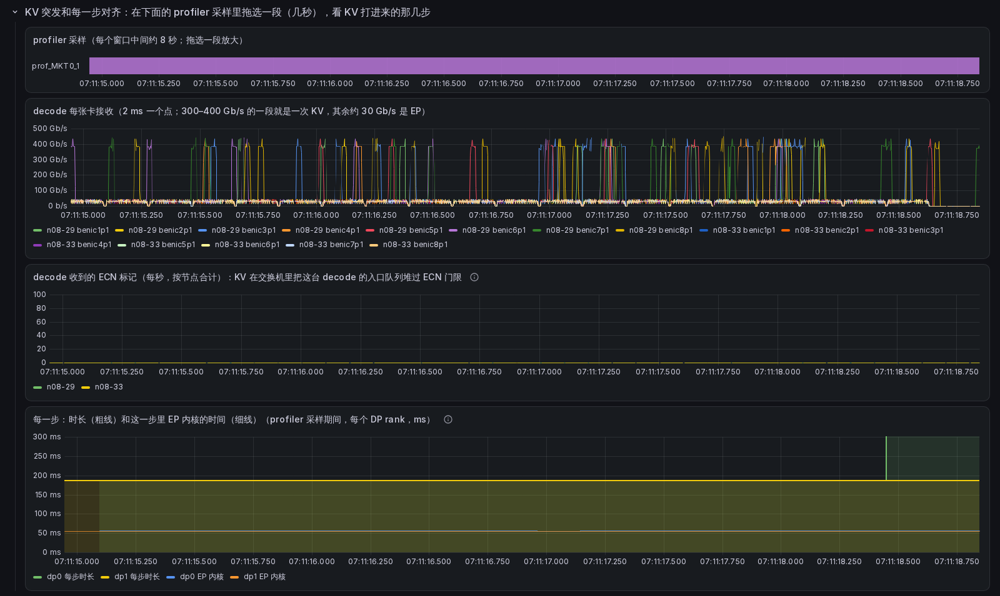

# smci355 上 EP × KV 实验的监控面板（Grafana）

所有实验的核心数据都推进同一个数据库，在一个 Grafana 面板里看：窗口时间线、decode 每步时长、EP 内核耗时、KV 每次传输的 p50 / p99、真实 PD 的 TTFT，以及每张网卡 2 ms 一个点的收发。profiler 采样的那几秒里，还能把 KV 突发、交换机的 ECN 标记和每一步的时长放在同一条时间轴上看（第 4 节）。跑完自动算一张“每个窗口一行”的汇总表，不同实验之间也能放在一张表里对比。

## 1. 怎么打开

- 在 Cursor 里打开 http://localhost:23300/d/epio （Cursor 会自动把登录节点的 23300 端口转发到本机）。用别的 SSH 客户端时，自己转发：`ssh -L 23300:127.0.0.1:23300 <登录节点>`。
- 不能直接用 IP 打开：公司网络到登录节点只放行 80 端口，80 端口已经被 ditian12 的 netmon Grafana 占用（集群日常监控，每 100 ms 采一次）。
- 面板上方选实验（`yutongwu-<run>`，例如 `yutongwu-e1x_7115`）。decode 节点、KV 来源会按这个实验自动填好。

## 2. 数据从哪来

| 类别 | 指标 | 谁推 | 粒度 |
|---|---|---|---|
| 网卡 | 每张卡的 RDMA 收发字节、CNP、ECN、重传、ACK 超时；PFC pause（ethtool） | ainic-netmon（mori PR #1000），每台节点上 `--push` | 2 ms（ethtool 1 s） |
| decode | 每个 DP rank 的步时 p50 / p90 / p99、每秒序列步数、在跑的序列 | `e2e/loadgen.py --push`（decode-only），`e2e/pd_proxy.py --push`（PD） | 1 s |
| 真实 PD | 每个请求的 TTFT、prefill 耗时、decode 等 KV（TTFT 减 prefill）；每秒 prefill / decode 请求数和 KV 块数 | `e2e/pd_proxy.py --push` | 每个请求 / 1 s |
| EP | MoRI dispatch / combine 每次调用的耗时（均值、p50、p90、p99，每个 rank 的均值）；采样期间每一步的时长和这一步里 EP 内核的时间（每个 DP rank） | `tools/ep_push.py`，每次 profiler 采样后解析 trace | 每个窗口一次；每步一个点 |
| KV（注入） | 每次传输的耗时、到达到完成（含排队）、MB | `mb/io_inject.py --push` | 每次传输 |
| 窗口 | 窗口开始 / 结束、IO 开始 / 结束、所有事件 | `e2e/windows.sh` 的 `ev` | 事件 |
| 汇总 | 每个窗口：每步、相对前面空档的变化、dispatch / combine 及相对 base、CNP/s、每卡接收、KV p50 / p99、重传、TTFT 和 decode 等 KV 的 p50 / p99 | `tools/epio_summary.py`，跑完后 | 每个窗口一行 |

- 数据库：我们自己的 VictoriaMetrics，登录节点上 `10.235.192.132:28528`，数据在登录节点本地盘 `/var/tmp/yutongwu_epio/vmdata`，保留 1 年。`tools/monitor_up.sh` 启动它和 Grafana，并核对端口上的进程确实是自己的（登录节点上 8428、18428、38428 是别人的库）。
- 推送都在后台线程里，库慢或连不上时只丢点，不影响实验。ainic-netmon 的推送丢了点时，跑完用记录文件重导一次（启动脚本自动做）。
- 节点推送要能连上登录节点的 28528：`e2e/e1.sh` 开跑前从 C 节点检查一次，连不上会在日志里写出来。

## 3. 面板

从上到下：

1. **窗口与 decode 性能**
   - 窗口时间线：哪个窗口在跑（绿），它的 IO 在跑（橙）。下面所有面板的时间轴都和它对齐。
   - decode 每步时长：每个 DP rank 每秒的 p50 / p99，取 30 秒中位数。profiler 采样的那几秒单步会到约 2.5 s，取中位数是为了不让这些尖峰把纵轴撑开。
   - decode 吞吐：每秒的序列步数和在跑的序列。
   - EP：每次 profiler 采样的 dispatch / combine（每个窗口一个点），以及每个 rank 的 dispatch 均值（看有没有个别 rank 慢）。
2. **KV 突发和每一步对齐**（第 4 节）：profiler 采样的时间线；decode 每张卡的接收（2 ms）；decode 收到的 ECN 标记；采样期间每一步的时长（粗线）和这一步里 EP 内核的时间（细线），每个 DP rank 一条。在采样时间线上拖选几秒，四个面板一起放大。
3. **KV / IO（注入的 KV）**：每次传输的耗时和“到达到完成”的 p50 / p99（30 秒滑动窗口），KV 吞吐和每秒传输次数。
4. **真实 PD**：TTFT、prefill、decode 等 KV 的 p50 / p99；每秒的 prefill / decode 请求和 KV 块。decode-only 的实验这一行为空。
5. **网卡（ainic-netmon）**：decode 每张卡的接收 / 发送（每个时间点内的平均）、接收在每个时间点内最高的 2 ms 速率（看 KV 尖峰，和 Moonshot 的截图同一种看法）、KV 来源每张卡的发送、收到的 ECN 标记（哪台节点的入口在排队）、收到的 CNP（谁发出的包在对端排了队）、重传和 ACK 超时、PFC。缩放到几秒以内能看到每个 2 ms 读数。
6. **汇总**：当前实验每个窗口一行；跨实验对比（上方“对比”里多选实验，每行“实验 / 窗口”）。

## 4. 怎么在 Grafana 上看出 KV 突发拖慢了 EP

### 4.1 收发字节的曲线看不出来

网卡收发字节的面板（以及文档里 `port_rcv_data` / `port_xmit_data` 那种图）只能看出 KV 什么时候来、多大、落在哪几张卡上，看不出 EP 有没有被拖慢，和每步时长的趋势也对不上：

- 拖慢发生在交换机的队列里：EP 的包排在 KV 后面，每个包多等几十到几百微秒，但一个字节也不少。EP 每一步要发的字节是固定的，变慢只是同样的字节摊到更长的一步里，发送的平均速率低 10% 左右，淹没在读数本身的抖动里。
- 一个读数是 2 ms，比一次 dispatch（0.3–0.6 ms）还长，读数里看不到单次 EP 的形状，更看不到它被拖长。
- decode 的接收计数里 EP 和 KV 混在一起，KV 一来，曲线就是 KV。

### 4.2 该看哪几个面板

第 2 行的四个面板共用一条时间轴，回答三个问题：

1. **KV 什么时候来**：decode 每张卡的接收。300–400 Gb/s 的一段就是一次 KV，其余约 30 Gb/s 是 EP。
2. **有没有在交换机里排队**：decode 收到的 ECN 标记。交换机往这台 decode 方向的出口队列超过 ECN 门限时，给经过的包打标记，KV 和排在它后面的 EP 都会被打。KV 在 TC 104 时，ECN 正好在每次 KV 突发的那几十毫秒里涨到每秒 10–40 万个（按节点合计；每张卡和自己的接收突发对得上，误差 2 ms 以内）；KV 在 TC 0 时一直是 0。
3. **EP 有没有被拖慢**：每一步的时长和这一步里 EP 内核的时间。只有被 KV 撞上的那几步会变长。

四分之一频率的 Moonshot 形状 KV（`e1wm_7248` 的 MKl，TC 104，只写 n08-29）：3.6 秒、19 步里有 4 步被 KV 撞上，ECN 跟着出现。这 4 步里 KV 突发分别持续 53、70、94、134 ms，步长分别是 197.0、202.7、208.5、218.5 ms，多出来的时间约为突发时长的四分之一；其余 14 步都是 184.5–186.9 ms。整个窗口平均只慢 0.3%，但被撞上的那几步慢 6%–18%。



同样形状的 KV 换到 TC 0（`e1wx_7248` 的 MKT0，Moonshot 的频率，KV 更密）：KV 照样到 400 Gb/s 以上，ECN 一直是 0，每一步都是 186 ms，EP 内核时间也是一条平线。右上角顶到 300 ms 的那一步约 2.3 秒，是 decode 本地 prefill，和 KV 无关。



### 4.3 按步统计

`tools/burst_align.py` 对每次采样做同样的对齐：一步里 decode（DP rank 0 所在节点）任一张卡上超过 100 Gb/s 的 2 ms 读数的字节合计为“这一步收到的 KV”（EP 自己到不了 100 Gb/s，没有 KV 的采样这一项是 0），再比较 KV 多的一半步和其余的步。超过中位数 1.5 倍的长步是 prefill 或停顿，不算。只写 n08-29（DP rank 0）的几轮：

| 采样 | KV | 每步时长：KV 多的一半 / 其余 | DP rank 0（收 KV 的那台）的 EP 内核时间 | DP rank 1（往它发 EP 的那台） |
|---|---|---|---|---|
| e1wx base | 没有 | 185.1 ms | 56.8 ms | 55.2 ms |
| e1wx MK | Moonshot 形状，TC 104 | **221.6 / 198.5 ms** | 65.1 / 57.8 ms | 89.1 / 68.6 ms |
| e1wm MK | 同上 | **227.4 / 199.7 ms** | 66.6 / 58.8 ms | 93.5 / 67.3 ms |
| e1wm MKl | 四分之一频率，TC 104 | **202.3 / 185.1 ms**（收到 KV 的 5 步 / 其余 14 步） | 59.9 / 56.0 ms | 70.7 / 54.6 ms |
| e1wx MKT0 | TC 0 | 186.2 / 186.4 ms | 56.2 / 56.3 ms | 55.0 / 54.9 ms |
| e1wx MKc2 | 2 MB 一批，TC 104 | 186.6 / 185.1 ms | 55.9 / 55.9 ms | 56.7 / 54.8 ms |
| e1wm MKg | 按步放行，TC 104 | 186.5 / 185.8 ms | 56.2 / 55.8 ms | 54.5 / 54.2 ms |

- TC 104 的线速 KV 撞上哪一步，哪一步就变长（MKl 那 5 步里有一步只沾到 4 ms 的突发，没变长）；TC 0、小批和按步放行时，KV 再多，步长也不变。
- 每步时长各个 rank 一样；EP 内核时间里含等别的 rank 的时间，所以各 rank 不同。KV 打进 A 时，往 A 发 EP 的那台（B）的 EP 内核时间涨得更多：它发往 A 的 EP 排在 KV 后面。
- 真实 PD 不适合这样按步比：KV 到达和新请求加入是同一件事（新请求先读 KV 再开始 decode），这一步的批大小跟着变，所以 KV 多的步本来就长一点，KV 在 TC 0 时也一样（`pdkrq0_7248`：214.4 / 208.8 ms；TC 104 的 `pdkr104_7115`：219.1 / 212.8 ms）。真实 PD 还是按整段比（`k31_smci355_pd_mitigation_zh.md` 第 2 节）。

离线画同样的图（`img/align_e1wx_MK.png`、`img/align_e1wx_MKT0.png`、`img/align_e1wm_MKl.png`）：

```bash
python3 tools/burst_align.py results/e2e/e1wm_7248 prof_MKl_1 --exp yutongwu-e1wm_7248 --node n08-29 --out align.png
```

### 4.4 收到的 ECN 和收到的 CNP 不是一回事

- **收到的 ECN 标记**：这台节点的入口在排队。KV 打进哪台 decode，哪台的 ECN 就涨，和它自己的 KV 突发同时出现。
- **收到的 CNP**：这台节点发出的包在对端被打了标记，对端回的 CNP。KV 打进 A 时，收到 CNP 的是往 A 发包的节点：KV 来源，以及往 A 发 EP 的另一台 decode。A 自己收到的 CNP 来自它发往别处的包，和它自己的 KV 突发无关。
- 例：`e1wx_7248` 的 MK 窗口只写 n08-29（整个窗口 142 秒的平均）：

  | 节点 | 收到的 ECN 标记 | 收到的 CNP |
  |---|---|---|
  | n08-29（被写的 decode） | 55,884/s | 0 |
  | n08-33（另一台 decode，往 n08-29 发 EP） | 0 | 5,470/s |
  | n08-25（KV 来源） | 0 | 37,171/s |

  MKT0（TC 0）和 base 里三台都是 0。
- 汇总表和各文档里的“decode 收到的 CNP”是第二种：decode 只发 EP 和 READ 请求，它收到 CNP，就是它发出的 EP 包在对端排了队。smci355 上 QP 默认在没开 DCQCN 的 profile 0，收到 CNP 不会降速，它只说明队列堆深了。

## 5. 一次实验怎么接进来

`tools/launch2.sh` 的 `e1x` / `e1g` / `e1w` / `e1i` / `pdk*` 阶段已经默认打开全部推送。自己写的阶段在环境里设：

```bash
export NETMON=1 NETMON_PUSH=http://10.235.192.132:28528 NETMON_EXP_PREFIX=yutongwu-   # ainic-netmon，PD 里可用 NETMON=nat 只录自然流量那段
export EPIO_PUSH=http://10.235.192.132:28528                                       # decode / EP / KV / 窗口
```

跑完：

```bash
python3 tools/epio_summary.py results/e2e/<run> --experiment yutongwu-<run>    # 汇总表，同时写 <run>/epio_summary.md
python3 tools/netmon_report/ainic_netmon_import.py import results/e2e/<run>/netmon/* \
    --url http://127.0.0.1:28528 --experiment yutongwu-<run> --replace           # netmon 精确数据（推送丢点时）
python3 tools/epio_dash.py                                                       # 改了面板定义后重新生成
python3 tools/ep_push.py results/e2e/<run> prof_<capture> --push http://127.0.0.1:28528 \
    --experiment yutongwu-<run> --wait 0 --steps-only                            # 补推某次采样的每步数据
```

改了面板定义后让 Grafana 重新读：`curl -X POST -u admin:<密码> http://127.0.0.1:23300/api/admin/provisioning/dashboards/reload`。往文档里放面板截图用 `tools/grafana_shot.py`（登录节点上的无头 Chromium，装在 `/var/tmp/yutongwu_epio/shotvenv`）。

## 6. 注意

- 网卡的 2 ms 读数偶尔会出现超过线速的点（例如 500 Gb/s）：这是读数时间戳的误差，ainic-netmon 用请求和回复的中间时刻估计采样时间，个别读数会偏。
- ainic-netmon 每个计数器有两份数据：`resolution="normal"`（2 ms）和 `resolution="low"`（100 ms，只在 2 ms 采样卡住的空档里补上，两份在时间上不重叠，`low` 约占 7%）。按时间求和、求平均时两份都要算（面板和汇总表都是这样）；画 2 ms 的曲线时只取 `normal`，并且不要按网卡名把两份合成一条。
- 每步的数据只在 profiler 采样期间有（每个窗口中间约 8 秒，19 步左右）。
- VictoriaMetrics 删除后马上重导同一批序列，新数据要过几秒才查得到；数值不受影响。
- 汇总表里同名的两个 base 窗口（开头和结尾各一次）合成一行，显示后一次。
