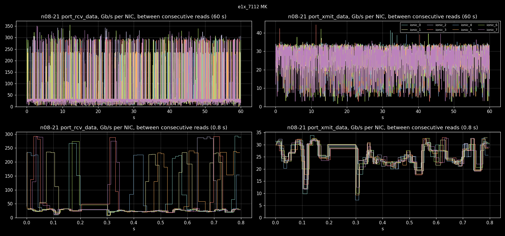
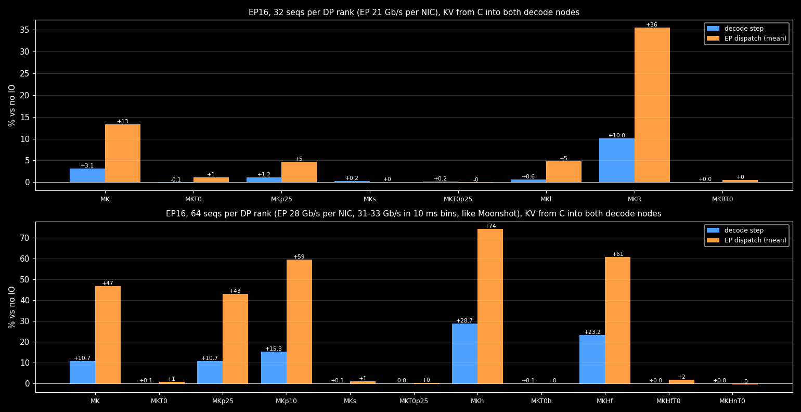
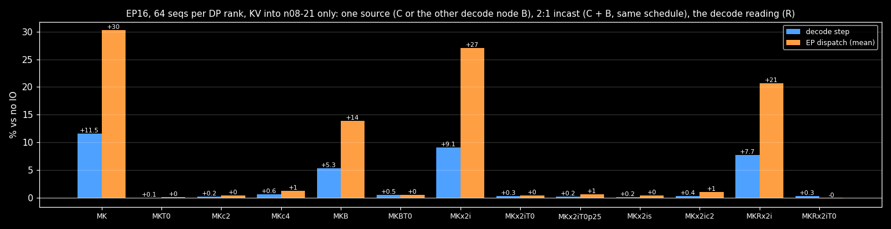

# smci355 上按 Moonshot 的流量复现 KV 对 EP 的影响（vLLM K3.1，EP16）

2026-11-25 夜里，作业 7112（3 台：n08-21、n08-25 做 decode，n09-29 做负载和 IO 来源）。

续篇：[真实 PD 和软件层面缓解](k31_smci355_pd_mitigation_zh.md)（真实 prefill 的 KV、KV 和 EP 错开、配置建议）；这些实验的数据都在 [Grafana 面板](k31_smci355_grafana_zh.md) 里。
这份文档只写这次用到的测试方法和结论。之前更多的测试方法见 [复现指南](k31_smci355_vllm_ep_io_repro_zh.md)，之前的结论见 [结论文档](k31_smci355_vllm_ep_io_zh.md)。

## 先说结论

1. **流量对上了。** 每个 rank 64 条时，按每张卡相邻两次读数（约 12 ms）算，EP 的平台是 31–34 Gb/s（Moonshot 30–37 Gb/s）。KV 按截图塑形：每张卡每秒约 2.5 次、每次 1 GiB 的线速突发，尖峰 230–390 Gb/s、每次 20–45 ms（Moonshot 250–400 Gb/s、20–40 ms）。曲线的样子和截图一样，每个读数在 Grafana 里都能看（2.5 节）。
2. **同样的流量，KV 和 EP 同在 TC 104 时，decode 每步慢 10.7%–11.5%**，EP dispatch 慢 30%–46%。KV 多一倍时慢 29%，写进跨 NUMA 的主机内存慢 23%，2:1 incast 慢 9%，decode 主动读慢 8%–10%。多出来的时间几乎都在 EP 上：EP 的包在交换机里排在 KV 后面，decode 每秒收到几千到上万个 CNP。
3. **KV 换到 TC 0 后，所有测过的场景里 EP 都回到 0.1%–0.5%。** 测过的场景包括：一个来源、频率加倍、写主机内存、decode 主动读、2:1 incast、decode 节点自己也在发 KV。**Moonshot 说的“走 TC 0 还慢 5%”，在 smci355 的 EP16 上没有复现。**
4. **TC 0 的代价在 KV 自己，而且只在拥塞时出现。** 一个来源时 KV 反而更快（每次 24 ms，TC 104 是 34 ms），也不丢包。2:1 incast 时，发送端每秒重传约 9.4 万个包，KV 每次的 p99 从 50 ms 变成 65 ms；decode 主动读再加 incast 时，p99 到 118 ms。
5. **比 TC 0 更好的办法：KV 留在无损的 TC 104，每次只提交 2–4 MB。**
   - 一个来源时，2 / 4 MB 一批每步只慢 0.2% / 0.6%，KV 每张卡 28 / 34 GB/s（16 MB 一批是 32 GB/s）。
   - 2:1 incast 时，2 MB 一批只慢 0.4%，不丢包，KV 的 p99 是 56 ms（TC 0 是 65 ms）。
   - 只限平均速率没有用：16 MB 一批限到 25 / 10 GB/s 时，每步仍慢 11% / 15%。
6. **5% 可能来自哪里（推测）。** 先排除一个：smci355 之前在 EP32 上测过，IO 换到 TC 0 后，一个来源和 2:1 incast 也都只剩 0.1%–0.3%（结论文档第 6.2 节、第 7 节）。所以“EP32 时 EP 自己就是 incast”在这里也解释不了 5%。更可能是环境不同：
   - IB 的 VL 仲裁和共享缓存。RoCE 的 TC 0 在出口单独排队、有损，IB 没有有损类。
   - 交换机给 KV 所在的类分了多少权重。
   - Mooncake Store 的节点同时也在对外发 KV。decode 节点当来源时，TC 104 下慢 5.3%，TC 0 下慢 0.5%。

## 1. Moonshot 的流量是什么样的

Moonshot 给了 decode 节点每张网卡 10 ms 精度的收发曲线（面板名 `IB std port_rcv_data / port_xmit_data`）。从截图上读出来：

| | 发送（port_xmit_data） | 接收（port_rcv_data） |
|---|---|---|
| 内容 | 只有 EP | EP + KV |
| EP | 方波：平台 30–37 Gb/s（约 4 GB/s），约 80 ms 一个周期（发约 55 ms、停约 25 ms），平均约 25 Gb/s | 约 25–30 Gb/s 的底 |
| KV | — | 叠在底上的尖峰：250–400 Gb/s（接近 400G 线速），每次 20–40 ms（每张卡约 0.6–1.5 GB），一次落在 2–3 张网卡上；截图里的几段繁忙时间，每张卡每秒约 2–3 次 |

已知的配置只有：EP32、全局 batch 512、qlen 8 会掉速；NVIDIA 的环境，KV 用 Mooncake Store。网卡速度、IB 还是 RoCE、IO 是怎么换到 TC 0 的，都不知道。

## 2. 测试方法

### 2.1 机器和配置

- decode：n08-21、n08-25，DP2 × TP8 · DCP8 = EP16，MoRI `mori_low_latency`，DSpark qlen 8，K3.1（镜像 `yukiozzz/vllm-openai-rocm:k31-ms-1114`）。
- n09-29（下面叫 C）：跑负载（随机 token，输入 1k，输出 128k–192k，整轮没有请求结束），同时是 KV 的来源，相当于 prefill 或者 Mooncake Store 的那一端。
- 每台 8 张 ionic 400G，rail-only：GPU i 只走网卡 i。EP 在 TC 104（唯一的无损类）；KV 默认也在 TC 104，`T0` 的窗口里在 TC 0（有损类）。

### 2.2 EP：每个 rank 64 条最接近 Moonshot

vLLM 的 K3.1 没有做 sequence-parallel MoE，同样的 batch，EP 的量比 Moonshot 大；所以用每个 rank 的条数来对 EP 的流量：

| 每个 DP rank 的条数 | 每步 | EP：每张卡发送，平均 | 按读数间隔（约 12 ms）的平台 |
|---|---|---|---|
| 16 | 94.5 ms | 14.4 Gb/s | — |
| 32 | 122 ms | 21 Gb/s | 约 23–25 Gb/s |
| **64** | **184 ms** | **28 Gb/s** | **31–34 Gb/s（p50 31、p99 34）** |
| Moonshot（EP32，全局 512） | 约 80 ms | 约 25 Gb/s | 30–37 Gb/s |

64 条时每张卡的 EP 流量和 Moonshot 的平台对上了，只是我们的一步更长。结论以 64 条为主，32 条作对照。

### 2.3 KV：按截图塑形的注入

`mb/io_inject.py` 的 KV 模式（窗口名以 `MK` 开头，定义在 `e2e/windows.sh`）：

- 每台 decode 的 KV 按泊松过程到达，平均每秒 6.7 次；每次随机落在 8 张卡里的 3 张上，所以每张卡平均每秒约 2.5 次。
- 每次每张卡 1 GiB，拆成 16 MB 一批，同时 2 批在途，线速连续发；GPU i → GPU i（同一条 rail），用 MoRI IO 的 RDMA WRITE 写进 decode 的 GPU 显存（`R` 是 decode 主动读，MoRIIO 的方向）。
- 空闲时一次 22.7 ms 传完（47 GB/s，376 Gb/s）。和 EP 一起、C 的网卡同时给两台 decode 发时，一次 33 ms 左右，按读数间隔算的尖峰是 230–390 Gb/s。每张卡平均 2.5–3 GB/s，和截图里的繁忙时段相当。
- 变体：

| 后缀 | 含义 |
|---|---|
| `T0` | KV 在 TC 0 |
| `l` / `h` | 到达频率 1/4 / 2 倍 |
| `p25` / `p10` | 每张卡限速 25 / 10 GB/s（16 MB 一批，批与批之间空出时间；25 GB/s 也等于 800G 网卡上同样的字节数占一半线速） |
| `s` / `c2` / `c4` | 1 / 2 / 4 MB 一批，一次只有一批在途 |
| `Hn` / `Hf` | 写进 decode 的主机内存（锁页），和网卡同一个 NUMA / 另一个 NUMA（模拟 Mooncake Store 那样的 DRAM 池） |
| `x2i` / `B` | incast：第二个来源 n08-25 和 C 同时写 n08-21（同一份时间表，每次都 2:1）/ 只有 n08-25 写 |

### 2.4 监控：nicmon，每张网卡的收发字节

`tools/nicmon.py` 在每台机器上读每张 ionic 网卡的 RDMA 收发字节（`hw_counters/tx_rdma_ucast_bytes`、`rx_rdma_ucast_bytes`），另外每 100 ms 读重传、CNP、ECN 和序号错。e2e/e1.sh 设 `NICMON=1` 时整轮都开着。两个坑：

- **原始数据就是计数器。** ionic 只提供累计计数，没有现成的速率。nicmon 的原始文件是每次读取的“读取时间 + 计数值”，值变了才记一行；速率是相邻两次读数相减、再除以时间差。Moonshot 面板上的 `port_rcv_data` / `port_xmit_data` 也是计数器，曲线同样是算出来的速率。
- **内核缓存。** 内核的 RDMA 统计会把这些计数缓存 10 ms（`hw_counters/lifespan`），读到的值最多旧 10 ms，算出来会有 1000 Gb/s 以上的假尖峰。所以运行期间把 `lifespan` 调成 1 ms（要 sudo，结束时恢复 10）。
- **读一次要从网卡取。** 调成 1 ms 后，每次读都走到网卡，负载下约 1.3 ms，偶尔约 95 ms。这次的 nicmon 是 8 张卡依次读，每张卡相邻两次读数的间隔：中位 11.8 ms，大部分在 10–22 ms，约 2% 超过 50 ms（读一次卡住，最长约 100 ms）。（一开始以为固件每 10.7 ms 才刷新一次，其实那是依次读的耗时。）

**这次数据的精度就是每张卡约 12 ms 一个点。** 图和 Grafana 里每个点都是相邻两次读数之间的平均速率，不插值、不对齐到固定格子。一次读本身要约 1.3 ms，读数对应的时刻有这么大的不确定，所以偶尔会有一个点略超线速。

`tools/nicmon.py` 已经改成每张卡一个线程并行读，预计每张卡约 1.5–2.5 ms 一个点。新版本还没在机器上跑过，下次有机器时先验证。

### 2.5 Grafana

登录节点上跑 VictoriaMetrics（只监听本机）和 Grafana（监听 23300 端口）：`bash tools/monitor_up.sh results/e2e/<run> ...` 会下载、启动、把 nicmon 的数据导进去（`tools/nicmon_to_vm.py`），并加载仿照 Moonshot 截图的面板（`tools/grafana_dash.py`）。

- 打开方式：浏览器直接打开 **http://10.235.192.132:23300/d/nicmon**（登录节点 n06-21 的内网 IP，匿名只读）。如果 Grafana 只监听本机（`GRAFANA_ADDR=127.0.0.1`），就在 Cursor / VS Code 的 Ports 里转发 23300，再打开 `http://localhost:23300/d/nicmon`。
- 面板：选定节点每张卡的接收 / 发送（Gb/s，每个点是相邻两次读数之间的平均速率）、每台机器的合计、CNP、重传、序号错、注入窗口的时间线、decode 每步。
- 运行名：`e1t1_7112` 是每个 rank 32 条，`e1x_7112` 是 64 条，`e1ra_7112` 是 incast。拉到 10–20 秒的范围就能看到每个读数（每张卡约 12 ms 一个）。

### 2.6 每个窗口怎么比

- 每个窗口 IO 开 120 s、关 60 s，同一轮里依次跑。
- 步时：客户端每 10 s 的 token 间隔中位数，和这个窗口前后 IO 关着的空档比。上下文一直在变长，一轮下来步时会慢慢涨 2–3%，所以不能都和开头的 base 比。两个 base 窗口自己的变化是 ±0.1%。
- EP 内核：每个窗口中间用 profiler 采 20 步，看 MoRI dispatch / combine 的耗时（各 rank 的均值再平均）。
- KV 自己：io_inject 记录每次传输的开始、结束（耗时）和到达时间（等前一次传完的时间也算进去，叫延迟），以及每张卡的速率；丢包看发送端的重传包和接收端的序号错。

## 3. 任务一：同样的流量下，KV 对 EP 的影响



上面两张是 60 秒，下面两张是其中 0.8 秒，每一段阶梯是一个读数间隔（约 12 ms）。接收那一侧，约 30 Gb/s 的 EP 底上叠着 220–300 Gb/s、20–40 ms 的 KV 尖峰，一次落在几张卡上；发送那一侧是 EP，20–33 Gb/s。和 Moonshot 的截图是一个样子。不注入时的同一张图见 `img/mk64_base1_traffic.png`。

**KV 和 EP 同在 TC 104：**

| 每个 rank | 窗口 | KV | 每步 | EP dispatch（均值） | decode 收到的 CNP（每秒） |
|---|---|---|---|---|---|
| 32 | MK | 写，每卡每秒约 2.5 次 1 GiB 线速突发 | +3.1% | +13% | 4,100 |
| 32 | MKl | 同上，频率 1/4 | +0.6% | +5% | 1,300 |
| 32 | MKR | decode 主动读（MoRIIO 的方向） | **+10.0%** | +35% | 9,500 |
| **64** | **MK** | 写，同上 | **+10.7%** | **+46%** | 5,900 |
| 64 | MKh | 同上，频率 2 倍（每卡平均约 5 GB/s） | **+28.7%** | +74% | 14,200 |
| 64 | MKHf | 写进 decode 另一个 NUMA 的主机内存 | **+23.2%** | +60% | 11,200 |



- **按 Moonshot 的流量，能复现明显的掉速。** EP 和 Moonshot 一样大（64 条）时，同样形状的 KV 让每步慢 10.7%，EP dispatch 慢 46%；KV 再多一倍，慢 29%。EP 越大，影响越大（32 条时 3%）。
- **多出来的时间几乎都在 EP 上。** 64 条时每步多 19.6 ms。profiler 里 dispatch 的均值从 357 µs 涨到 522 µs，combine 从 245 µs 涨到 271 µs；每步各 92 次，合计约 17.5 ms。decode 每秒收到几千到上万个 CNP：EP 的包在交换机里排在 KV 后面，被打了 ECN 标记（机制见结论文档第 4 节：smci355 上 DCQCN 不降速，变慢来自排队本身）。
- **读比写重**（32 条：+10% 对 +3%），和之前的结论一致。
- **写进跨 NUMA 的主机内存最重**（+23%）：网卡往另一颗 CPU 的内存写不够快，在无损类里只能往回施压，同一个流量类里的 EP 也被拖住。

## 4. 任务二：KV 走 TC 0，以及有没有更好的办法

### 4.1 KV 走 TC 0

| 每个 rank | 窗口 | 每步 | EP dispatch | CNP | KV 每次 p50 / p99 | KV 每张卡 | 重传（发送端，每秒） |
|---|---|---|---|---|---|---|---|
| 64 | MK（TC 104，对照） | +10.7% | +46% | 5,900 | 33.6 / 45.1 ms | 31.8 GB/s | 0 |
| 64 | **MKT0** | **+0.1%** | 0% | 0 | **23.9 / 44.9 ms** | **44.8 GB/s** | 0 |
| 64 | MKT0h（频率 2 倍） | +0.1% | 0% | 0 | 25.9 / 45.4 ms | 41.3 GB/s | 0 |
| 64 | MKHfT0（跨 NUMA 主机内存） | +0.0% | +2% | 0 | 23.8 / 43.9 ms | 45.0 GB/s | **3,400 包** |
| 64 | MKHnT0（同 NUMA 主机内存） | +0.0% | −1% | 0 | 23.8 / 44.3 ms | 45.0 GB/s | 0 |
| 32 | MKRT0（读） | +0.0% | 0% | 0 | 23.3 / 44.3 ms | 46.0 GB/s | 0 |

- **EP 完全恢复。** 一个来源时，不管写还是读、写进显存还是主机内存、频率加倍，KV 换到 TC 0 后每步都在 ±0.1% 以内，decode 收不到 CNP。**一个来源测不出 Moonshot 说的 5%**（incast 见 4.3）。
- **KV 自己反而更快。** 在 TC 104 里 KV 和 EP 排同一个队列，每次 33.6 ms；换到 TC 0 后有自己的队列，每次 23.9 ms，每张卡 45 GB/s。
- **有损类的代价。** 一个来源写进显存时没有丢包。写进跨 NUMA 的主机内存时，接收端排不出去，TC 0 里开始丢包，发送端每秒重传约 3,400 个包；但 KV 每次的耗时和 p99 没变（23.8 / 43.9 ms），EP 也不受影响。incast 时的代价见 4.3。

### 4.2 软件层面：拆小、限速

| 每个 rank | 窗口 | 办法 | 每步 | EP dispatch | CNP | KV 每次 p50 / p99 | KV 每张卡 |
|---|---|---|---|---|---|---|---|
| 64 | MK | 16 MB 一批，2 批在途（对照） | +10.7% | +46% | 5,900 | 33.6 / 45.1 ms | 31.8 GB/s |
| 64 | **MKs** | **1 MB 一批，1 批在途** | **+0.1%** | +1% | 0 | 54.0 / 71.8 ms | 19.9 GB/s |
| 64 | MKp25 | 每卡限速 25 GB/s（仍是 16 MB 一批） | +10.7% | +43% | 7,200 | 42.7 / 45.3 ms | 25.1 GB/s |
| 64 | MKp10 | 每卡限速 10 GB/s | **+15.3%** | +59% | 12,200 | 106 / 106 ms | 10.1 GB/s |
| 64 | MKT0p25 | TC 0 加限速 25 GB/s | −0.0% | 0% | 0 | 42.6 / 45.3 ms | 25.1 GB/s |
| 32 | MKs | 1 MB 一批 | +0.2% | 0% | 0 | 50.4 / 59.0 ms | 21.3 GB/s |
| 32 | MKp25 | 限速 25 GB/s | +1.2% | +5% | 4,700 | 42.6 / 45.6 ms | 25.1 GB/s |

2 MB、4 MB 一批是在 4.3 那一轮里测的（C 只打 n08-21，同一轮的 16 MB 一批是 +11.5%）：

| 窗口 | 办法 | 每步 | EP dispatch | CNP | KV 每次 p50 / p99 | KV 每张卡 |
|---|---|---|---|---|---|---|
| MK | 16 MB 一批，2 批在途（对照） | +11.5% | +30% | 6,300 | 32.4 / 34.4 ms | 33.0 GB/s |
| **MKc2** | **2 MB 一批，1 批在途** | **+0.2%** | 0% | 3 | 38.7 / 42.0 ms | 27.7 GB/s |
| **MKc4** | **4 MB 一批，1 批在途** | **+0.6%** | +1% | 2,200 | **32.1 / 34.2 ms** | **33.5 GB/s** |
| MKT0 | 16 MB 一批，TC 0 | +0.1% | 0% | 0 | 23.8 / 24.6 ms | 45.0 GB/s |

- **拆小有用，限速没用。** 16 MB 一批时，网卡把一批对着同一个出口线速连续发完（约 0.35 ms），这段时间里 EP 的包排在后面；限速只是把批与批之间拉开，每一批照样是线速，同样多的字节摊得更开，撞上 EP 的次数反而更多（限到 10 GB/s 时 +15%）。1 MB 一批时一段线速只有约 20 µs，堆不起队列，EP 不受影响。
- **拆小的代价在 KV 自己，2–4 MB 是折中点。** 这里的注入工具一次只挂一批，1 MB 一批时每张卡只能跑到 20 GB/s，一次 1 GiB 要 54 ms；2 MB 一批 28 GB/s、39 ms；4 MB 一批 34 GB/s、32 ms，和 16 MB 一批一样快，EP 只慢 0.6%。（TC 0 不拥塞时 45 GB/s、24 ms。）

### 4.3 incast：能不能复现“走 TC 0 还慢 5%”

**做法：** 只有 3 台机器，第二个来源用另一台 decode（n08-25）。
- C 和 n08-25 按同一份时间表、同时把 KV 写进 n08-21：每次两个来源各 1 GiB 落在同样的 3 张卡上，每次都是 2:1 incast。
- 每个来源的频率减半，总字节数和一个来源时一样。
- n08-25 同时还在发 EP，所以另测“只有 n08-25 写”（`MKB`），把发送端自己的争用分开。
- 每个 rank 64 条，只打 n08-21。

| 窗口 | KV | 每步 | EP dispatch | CNP | KV 每次 p50 / p99 | 重传（每秒） |
|---|---|---|---|---|---|---|
| MK | C → n08-21，一个来源 | +11.5% | +30% | 6,300 | 32.4 / 34.4 ms | 0 |
| MKT0 | 同上，TC 0 | +0.1% | 0% | 0 | 23.8 / 24.6 ms | 0 |
| MKB | n08-25 → n08-21（来源自己也在发 EP） | +5.3% | +14% | 0 | 23.6 / 27.5 ms | 0 |
| MKBT0 | 同上，TC 0 | +0.5% | 0% | 0 | 23.9 / 26.7 ms | 0 |
| MKx2i | 2:1 incast，TC 104 | +9.1% | +27% | 4,900 | 29.1 / 49.7 ms | 0 |
| **MKx2iT0** | **2:1 incast，TC 0** | **+0.3%** | 0% | 0 | 23.9 / **64.6 ms** | **9.4 万包** |
| MKx2iT0p25 | 2:1，TC 0，每个来源限速 25 GB/s | +0.2% | 0% | 0 | 42.6 / 73.4 ms | 13.7 万包 |
| **MKx2ic2** | **2:1，TC 104，2 MB 一批** | **+0.4%** | +1% | 750 | 39.2 / **56.2 ms** | **0** |
| MKx2is | 2:1，TC 104，1 MB 一批 | +0.2% | 0% | 1 | 53.9 / 72.7 ms | 0 |
| MKRx2i | 2:1，n08-21 从两边读，TC 104 | +7.7% | +20% | 5,200 | 27.1 / 51.2 ms | 0 |
| MKRx2iT0 | 同上，TC 0 | +0.3% | 0% | 0 | 23.8 / **118.4 ms** | 118 包 |



- **2:1 incast 时 KV 走 TC 0，EP 也只慢 0.3%，还是没有复现 5%。** 这时 n08-21 的网卡已经被打满，尖峰到约 390 Gb/s（`img/mk64_MKx2i_traffic.png`）。
- **TC 0 在 incast 时开始丢包。**
  - 写入时，两个来源每秒共重传约 9.4 万个包，KV 每次的 p99 从 49.7 ms 涨到 64.6 ms。
  - 再加限速，丢包反而更多，因为限速之后仍是 16 MB 一批。
  - decode 主动读时丢包少（每秒 118 个），但每丢一次都要等重传超时，p99 到 118 ms。
- **来源自己也在发 EP 时**（像 Mooncake Store 的节点也给别人供 KV），即使 KV 不和 EP 在交换机里排队（decode 收不到 CNP），来源网卡里 EP 和 KV 抢发送，也让每步慢 5.3%。KV 换到 TC 0 后只剩 0.5%。
- **2 MB 一批留在 TC 104，对 EP 的效果和 TC 0 一样（+0.4%），而且不丢包，KV 的 p99 更短**（56 ms，TC 0 是 65 ms）。代价是不拥塞时每张卡只跑 27 GB/s。

### 4.4 建议

- **只能改流量类时，KV 换到 TC 0。** smci355 上，所有测过的场景里 EP 都完全恢复。代价是拥塞（incast）时 KV 丢包、尾延迟变长，decode 主动读的方式更明显。
- **更好的做法：KV 留在无损类，传输引擎把每次提交限制在 2–4 MB，每个 QP 一次只挂少量。**
  - 一个来源和 2:1 incast 时，EP 都只慢 0.2%–0.6%，KV 不丢包。
  - 要把吞吐补回来，可以多开 QP、多个小批并行。这次没测；之前端到端测过 1 MB 一批、同时 16 批在途，只慢 0.9%（结论文档第 3 节）。
- **两种也可以叠加：TC 0 加小批。** 小批让 incast 时队列浅，TC 0 也就少丢包（这次没测）。
- **不要只限平均速率。** 只要单次提交还是 16 MB，限得越低，撞上 EP 的次数越多。
- **KV 落在主机内存时，放在网卡同一个 NUMA 上。** 跨 NUMA 时网卡往内存写不及：在无损类里会拖慢 EP（+23%），在 TC 0 里会丢包。
- **值得向 Moonshot 确认的：**
  - Mooncake 传输引擎每次提交多大、同时挂几个；
  - KV 和 EP 的 SL / TC，以及交换机上是严格优先还是按权重调度；
  - decode 节点是否同时也是 Mooncake Store 的存储节点（会对外发 KV）；
  - 是 IB 还是 RoCE，网卡多少 G。

## 5. 和 Moonshot 环境的差别

- **EP16 对 EP32。** EP32 每台 decode 同时收另外 3 台的 EP，EP 自己就是 3:1 的 incast（smci355 上 EP32 不注入时每台就有每秒几千个 CNP）；EP16 只有 1 台。机器有限，这次只测 EP16，用加大 EP（每个 rank 64 条）和加大 KV 来补。之前 EP32 上的 TC 0 数据（16 MB 一批的注入）：一个来源 +0.3%，2:1 incast +0.1%（结论文档第 6.2 节、第 7 节）。
- **网卡和网络。** smci355 是 ionic 400G、RoCE、rail-only，TC 0 是有损类，交换机按流量类分队列。Moonshot 的面板名是 `IB std port_rcv_data`：如果是 InfiniBand，就没有“有损的 TC 0”，换 TC 是换 SL / VL，VL 之间按权重仲裁、靠信用流控，KV 的 VL 满了也会通过共享缓存影响别的 VL，这和我们的情况不同。如果是 800G 网卡，同样的字节数只占一半线速（`p25` 那一档）。
- **KV 的来源和落点。** Mooncake Store 的 KV 可能来自多台机器（incast），也可能落在主机内存（`Hn` / `Hf`），这两种这次都测了；KV 的单次提交大小和在途量我们不知道，它决定了排队有多深（4.2）。
- **我们一步更长**（184 ms 对约 80 ms），EP 在一步里占的时间比例不同。

## 6. 复现

```bash
# 3 台的 holder 作业（tools/holder.sbatch），然后在登录节点上：
cat > logs/env_e1x_<job>.txt << 'EOF'
export RAIL_ALIGN=1 PRE_RECV=1 CONC=64 SERVE_ENV="MAX_SEQS=64" OSL=128000 NICMON=1 WARM=180
EOF
echo "base MK MKT0 MKp25 MKp10 MKs MKT0p25 MKh MKT0h MKHf MKHfT0 MKHnT0" > logs/windows_e1x_<job>.txt
nohup bash tools/launch.sh <job> setup e1x > /dev/null 2>&1 &
# incast（第二台 decode 也当来源，只打第一台 decode）：
#   env 里再加 SOURCES="$C $B" TARGETS="$A"，窗口如 "base MK MKT0 MKB MKBT0 MKx2i MKx2iT0 MKx2is MKRx2i MKRx2iT0"
# 分析和画图：
python3 tools/mk_analyze.py results/e2e/e1x_<job> --plots results/e2e/e1x_<job>/mkplots
python3 tools/fig_mk.py traffic results/e2e/e1x_<job> MK mk_traffic.png
python3 tools/fig_mk.py impact mk_impact.png "64 seqs per DP rank=results/e2e/e1x_<job>"
# Grafana：
bash tools/monitor_up.sh results/e2e/e1x_<job>
```

脚本都在 `docs/epio/smci355_vllm/` 下（`tools/nicmon.py`、`tools/nicmon_load.py`、`tools/nicmon_to_vm.py`、`tools/grafana_dash.py`、`tools/monitor_up.sh`、`tools/mk_analyze.py`、`tools/fig_mk.py`、`mb/io_inject.py`、`e2e/windows.sh`、`e2e/e1.sh`）。
