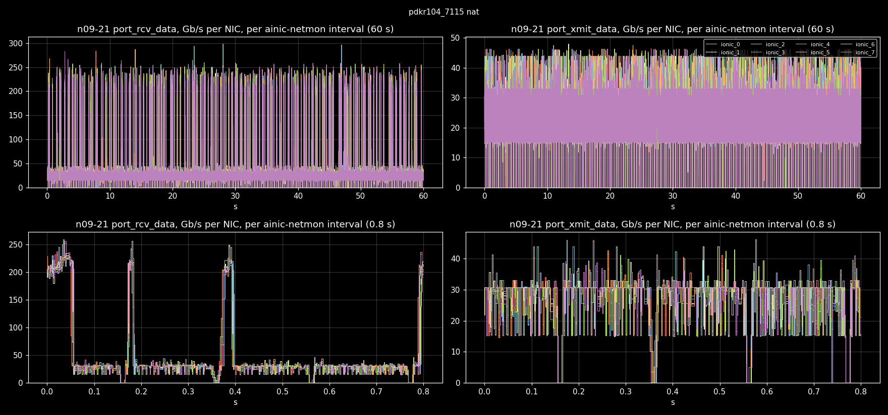
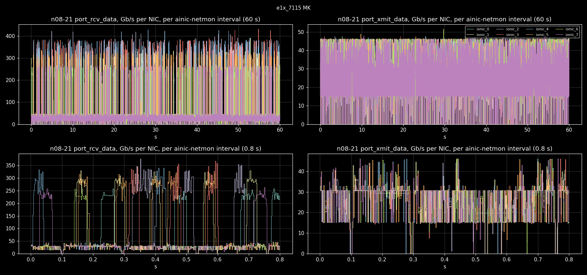

# smci355 上真实 PD 和软件层面缓解：KV 对 EP 的影响（vLLM K3.1，EP16）

续 `k31_smci355_moonshot_traffic_zh.md`。那份文档用注入的 KV 复现了 Moonshot 的流量，这份做两件事：用真实 prefill 的 KV 验证那些缓解办法，以及测“KV 和 EP 错开”。所有数据都在 Grafana 里（`k31_smci355_grafana_zh.md`），实验名 `yutongwu-<run>`。

## 先说结论

1. **真实 PD（vLLM K3.1 默认的 MoRIIO READ）里，KV 不拖慢 EP。** KV 量已经接近 Moonshot（每台 decode 每秒约 19 GB），但 KV 留在 TC 104、换到 TC 0、限制在途，每步都是 215 ms，TTFT 也一样。原因是真实 KV 每次传输只用一个 QP、按层读，每张卡只到 200–230 Gb/s，没到线速，交换机里排不起队。所以 READ 模式下不用改配置；TC 0 和限在途没有好处，TC 0 还带来少量重传。
2. **想让 KV 更快（多开 QP、开 chunking）时，要配合限在途或 TC 0。** 注入的线速 KV 让每步慢 12.5%；1 MB 一块、每个 QP 4 块在途的配置在真实 PD 上能正常跑。配置写在第 5 节，也写进了 mori 的文档。
3. **KV 和 EP 错开有效，但不如小批或 TC 0 实用。** decode 每进入一步发一个信号，KV 只在步与步之间的空档里发，EP 的影响从 +4.6% 降到 +0.1%；代价是 KV 每次多等约一步（p50 约 270 ms），而且空档每台每秒只能放约 11 GB，KV 再多就越积越多。同样的 KV 用 4 MB 小批或 TC 0，EP 只慢 0.1%–0.2%，KV 不增加延迟。
4. **WRITE 模式在这个镜像上跑不起来**：修好代理的握手后单个请求能通，上了负载 TTFT 约 700 秒。
5. **监控**：所有数据（窗口、decode 每步、EP 内核、KV p50 / p99、TTFT、2 ms 网卡）都在 Grafana 面板里，每个实验自动出一张汇总表，见 `k31_smci355_grafana_zh.md`。

## 1. 怎么测

### 1.1 真实 PD

- 3 台：1 台 prefill（TP8），2 台 decode（DP2 × TP8 × DCP8 = EP16，每个 rank 64 条）。MoRIIO，KV 在 READ 模式下由 decode 读，WRITE 模式下由 prefill 写。
- 负载（`e2e/loadgen.py`）：每个请求 66,048 个 token，其中 65,536 个来自 4 个共享前缀（prefill 的前缀缓存里有，只算后面 512 个），decode 关掉前缀缓存，所以每个请求的完整 KV 都要从 prefill 传到 decode；输出 64 个 token（± 25%），请求周转快，KV 量大。并发 128（每个 decode rank 64）。
- 每个请求的 KV 约 1.35 GB（MLA 24 层 fp8 约 0.91 GB，KDA 69 层 float32 状态约 0.43 GB），8 张卡各读约 170 MB。
- 每段先跑 300 秒热身，再测 600 秒自然流量：ainic-netmon 2 ms 记录网卡，中间 profiler 采一次 EP 内核，代理记录每个请求的 TTFT、prefill 耗时和 decode 等 KV 的时间。

### 1.2 注入的 KV（错开、incast）

和 Moonshot 文档一样：decode-only 的 EP16，第三台当 KV 来源，每个 rank 64 条。错开的那两组改用接近真实 PD 的 KV 形状：每次 8 张卡各 170 MB，每台 decode 每秒 5 次。

## 2. 真实 PD

### 2.1 READ 模式（vLLM K3.1 的默认）

| 实验 | KV | 每步 | dispatch / combine | decode CNP/s | 重传/s | TTFT p50 / p99 | decode 等 KV p50 / p99 |
|---|---|---|---|---|---|---|---|
| `pdkr104_7115` | TC 104 | 215.0 ms | 364 / 378 µs | 45 | 0 | 1077 / 1727 ms | 602 / 813 ms |
| `pdkr0_7115` | TC 0 | 215.0 ms | 349 / 440 µs | 0 | 23 | 1081 / 1744 ms | 606 / 797 ms |
| `pdkrb_7115` | TC 104，1 MB 一块、每个 QP 最多 4 块在途 | 215.1 ms | 387 / 357 µs | 0 | 0 | 1086 / 1805 ms | 601 / 830 ms |

- KV 量已经接近 Moonshot：decode 每张卡平均收 47 Gb/s，其中 EP 约 28 Gb/s，KV 约 19 Gb/s，每台 decode 每秒约 19 GB；prefill 每秒完成约 20 个请求。
- KV 的突发：每张卡每 2 ms 的接收 p90 196 Gb/s、p99 226 Gb/s，9% 的时间超过 200 Gb/s；拆小后 p99 206 Gb/s，超过 200 Gb/s 的时间降到 1.6%。
- **三种做法每步一样（215 ms），EP 不受影响，TC 0 和拆小都没有好处**（只去掉了 CNP；TC 0 还带来每秒 23 个重传包）。


上面两张是 60 秒，下面两张是其中 0.8 秒。接收那一侧，约 30 Gb/s 的 EP 底上，每一步来一次 KV：8 张卡同时 200–250 Gb/s，持续 10–50 ms。作为对照，注入的 Moonshot 形状的 KV（`e1x_7115` 的 MK 窗口）是每次落在 3 张卡上、250–380 Gb/s 的线速突发：



- **原因不是错开，是 KV 没到线速。** profiler 里 CPU 经常在 GPU 还在算上一步时就进入下一步（上一步的 14–138 ms 处），新请求的 KV 读就在这时发起，和上一步的 EP 重叠；每台 decode 每步要收约 3.2 GB，按每张卡约 200 Gb/s 要 16 ms，比步与步之间的空档（约 11 ms）长。但真实 KV 每次传输只用一个 QP、按层读，每张卡的突发只有约 200–230 Gb/s，加上 EP 的约 31 Gb/s，离 400 Gb/s 的出口还远，交换机里排不起队（decode 每秒只收到 45 个 CNP）。注入的 KV 是 16 MB 一批、2 批在途的线速长串（380–420 Gb/s），所以会拖慢 EP（`e1x_7115`：+12.5%）。
- combine 比 decode-only 时长（约 250 µs → 360–440 µs），TC 0 下也一样，是真实负载（66k 的上下文、每一步都有新请求进来）造成的，不是 KV。
- KV 再翻倍（输出 32 个 token，`pdkrh_7115`）时，瓶颈先到 prefill：decode 每张卡只从 47 涨到 50 Gb/s，TTFT p99 涨到 4.3 s（请求在 prefill 排队）。一台 prefill 每秒约 20 个这样的请求就满了。

### 2.2 WRITE 模式

在这个 vLLM K3.1 镜像上跑不起来，没有测到数据：

- 代理原先只在 request id 里带一台 decode 的地址，prefill 按 `remote_dp_size` 去同一个地址找 DP rank 1，握手永远等不到（`Timed out waiting for write_ready_flags`）。`e2e/pd_proxy.py` 补上 `remote_hosts`（每个 DP rank 的地址）和 `remote_dp_size_local`（1）之后，单个请求能走通。
- 上了负载（128 并发）后，TTFT 约 700 秒（`pdkw104_7115`），基本是在等超时，decode 几乎不出 token。没有继续排查，WRITE 模式的测试留到以后。

## 3. KV 和 EP 错开

### 3.1 decode 一步里什么时候有 EP

profiler 的时间线（decode-only，每个 rank 64 条，`e1x_7112` 的 base；真实 PD 的 `pdkr104_7115` 差不多）：

- 每步约 185 ms（PD 里约 210 ms），92 层 MoE，dispatch + combine 合计约 56 ms，只占 30%。
- 层与层之间有 0.5–1 ms 的空档；步与步之间有一段约 9.5 ms（PD 里约 11 ms）完全没有 EP 的时间，GPU 在算线性注意力的状态、draft 模型和机内通信。
- 按线速算，这段空档每张卡每步最多能放约 6 ms × 45 GB/s ≈ 270 MB，每台 decode 每秒约 11–12 GB。Moonshot 那种 KV（每台每秒约 20 GB）装不下；真实 PD 的 KV（每台每秒约 19 GB）也装不下。
- decode-only 时 CPU 在上一步最后一个 combine 之后约 3 ms 进入下一步（离下一个 dispatch 约 6 ms），正好在空档里；真实 PD 里 CPU 常常提前进入（见 2.1），所以 READ 模式的 KV 读并不在空档里。

### 3.2 怎么错开

decode 每进入一步就发一个信号（`e2e/step_tick_patch.py`：vLLM worker 的 `execute_model` 开头，DP rank 0 的每个 GPU 给本机和 KV 来源各发一个 UDP 包），KV 的发送端只在收到信号后发，每张卡每步最多 `MK_GATE_MB`（256 MB），一次性提交，没发完的排到下一步（`mb/io_inject.py --gate-port`）。写入方向（KV 来源写 decode，Mooncake Store 的方向）在 KV 来源上收信号，读取方向在 decode 上收。

### 3.3 结果：写入方向，接近真实 PD 的 KV 形状

每次 8 张卡各 170 MB，每台 decode 每秒 5 次（每张卡约 0.85 GB/s），只写第一台 decode（`e1w_7115`、`e1w2_7115`）：

| 窗口 | 办法 | 每步 | dispatch | CNP/s | KV 每次 p50 / p99 | 到达到完成 p50 / p99 | KV 吞吐 |
|---|---|---|---|---|---|---|---|
| MK | 不错开，TC 104 | +4.4% / +4.6% | +12% / +9% | 2,700 | 5.8 / 7.0 ms | — / 9.8 ms | 7.2 GiB/s |
| **MKg** | **按步放行，TC 104** | **+0.1%** | +3%（采样误差内） | 22 | — | **约 270 ms / 1.6 s** | 7.2 GiB/s |
| MKc4 | 4 MB 一批、1 批在途，TC 104 | +0.2% | +0.3% | 768 | 5.2 / 5.6 ms | — / 8.6 ms | 7.0 GiB/s |
| MKT0 | 不错开，TC 0 | +0.1% | −0.4% | 0 | 4.2 / 4.3 ms | — / 6.4 ms | 7.3 GiB/s |
| MKh | 两倍量，不错开 | +8.9% | +30% | 4,965 | 5.7 / 7.1 ms | — / 10.8 ms | 13.6 GiB/s |
| MKhg | 两倍量，按步放行 | +0.1% | +1% | 30 | — | 17 s / 34 s，越排越长 | 10.4 GiB/s（要求 14.6） |

- **错开能把 EP 的影响完全去掉**（+4.6% → +0.1%），KV 不丢包、也不用换流量类。
- **代价在 KV 的延迟**：每次要等下一步开头，再和别的 KV 排队，从到达到传完 p50 约 270 ms、p99 约 1.6 s（不错开时 10 ms 以内）。这对 TTFT 是实打实的增加。
- **容量有上限**：两倍量时每张卡每步 256 MB 不够，队列越排越长（结束时每张卡还积着约 350 次），KV 只能跑到 10.4 GiB/s。
- 同样的 KV，4 MB 一批或者 TC 0 也能把影响压到 0.1%–0.2%，而且 KV 不增加延迟。所以在 smci355 上，错开不如小批或 TC 0 实用，除非 KV 量远小于空档的容量、又不能用 TC 0。

## 4. incast 下 TC 0 加小批

（跑完后补）

## 5. PD 里 IO 怎么配

- **vLLM K3.1 的 MoRIIO READ（默认）：不用改。** 每次传输一个 QP，每张卡的 KV 只到线速的一半左右，EP 不受影响；换 TC 0 或限在途都没有好处，TC 0 还多了重传。
- **想让 KV 更快（`qp_per_transfer` 调大、开 chunking 拿带宽）时，要重新看 EP。** KV 一到线速，EP 就会排在它后面（注入的线速 KV：每步 +12.5%）。这时二选一：
  - 限制每个 QP 的在途字节数，KV 留在无损的 TC 104：
    ```bash
    MORI_IO_ENABLE_CHUNKING=1 MORI_IO_CHUNK_BYTES=1048576 MORI_IO_MAX_CHUNKS=4096 \
    MORI_IO_QP_MAX_SEND_WR=4 MORI_IO_POST_BATCH_SIZE=4 VLLM_MORIIO_POST_BATCH_SIZE=4
    ```
    每个 QP 最多 4 MB 在途；`POST_BATCH_SIZE` 不能超过 SQ 深度，否则提交直接失败（`SQ request exceeds capacity`），connector 不会重试；`MAX_CHUNKS` 要够大，默认的 64 会把块放大。真实 PD 上这组设置能正常跑（`pdkrb_7115`，2 万个请求没有错误），突发从 p99 226 Gb/s 降到 206 Gb/s。
  - 或者 KV 换到 TC 0（`KV_TC=0`，即 `MORI_IO_TC=0`）：单来源不丢包，EP 只慢 0.1%；多个来源同时写一张卡（incast）时会重传，KV 的尾延迟变长（第 4 节）。
- **推送式的 KV（Mooncake Store、WRITE）同理**：它们没有 READ 那种“每步只读新请求”的节奏，KV 什么时候到都可能撞上 EP，按上面两种办法配。
- **错开（第 3 节）需要改代码**（vLLM 里在每一步开头发信号，传输引擎按步放行），能把 EP 的影响完全去掉，但 KV 每次要多等一步左右（p50 约 270 ms），而且每台每秒只能放约 11 GB。在 smci355 上不如上面两种配置实用。
- mori 的文档里也写了这部分：`docs/MORI-IO-GUIDE.md` 的 “Sharing NICs with MoRI EP”（isytwu/mori 的 `io-kv-next-to-ep` 分支）。

## 6. 复现

脚本在 `smci355_vllm/`，监控见 `k31_smci355_grafana_zh.md`。一个 3 台的 holder 作业（`tools/holder.sbatch`），在登录节点上：

```bash
bash tools/monitor_up.sh                                   # VictoriaMetrics + Grafana（一次）
# 真实 PD：logs/env_pdkr104_<job>.txt 里设 CONC=128 ISL=66048 PREFIX_LEN=65536 PREFIXES=4 OSL=64 OSL_JITTER=0.25
#   SERVE_ENV="MAX_SEQS=64 EXTRA_ARGS=--no-enable-prefix-caching" KVMODE=read KVTC=104 KV_ENV=""（TC 0：KVTC=0；限在途：KV_ENV 见第 5 节）
# 错开：logs/env_e1w_<job>.txt 里 SERVE_ENV="MAX_SEQS=64 YT_STEP_TICK_PORT=47000" MK_MB=170 MK_NICS=8 MK_RATE=5 MK_GATE_MB=256，
#   logs/windows_e1w_<job>.txt：base MK MKg MKc4 MKT0 MKh MKhg
echo "setup pdkr104 pdkr0 pdkrb e1w" > logs/phases_<job>.txt
nohup bash tools/launch2.sh <job> > /dev/null 2>&1 &
```

每段跑完，启动脚本自动算汇总表（Grafana 和 `results/e2e/<run>/epio_summary.md`）并把 ainic-netmon 的记录重导一遍。
